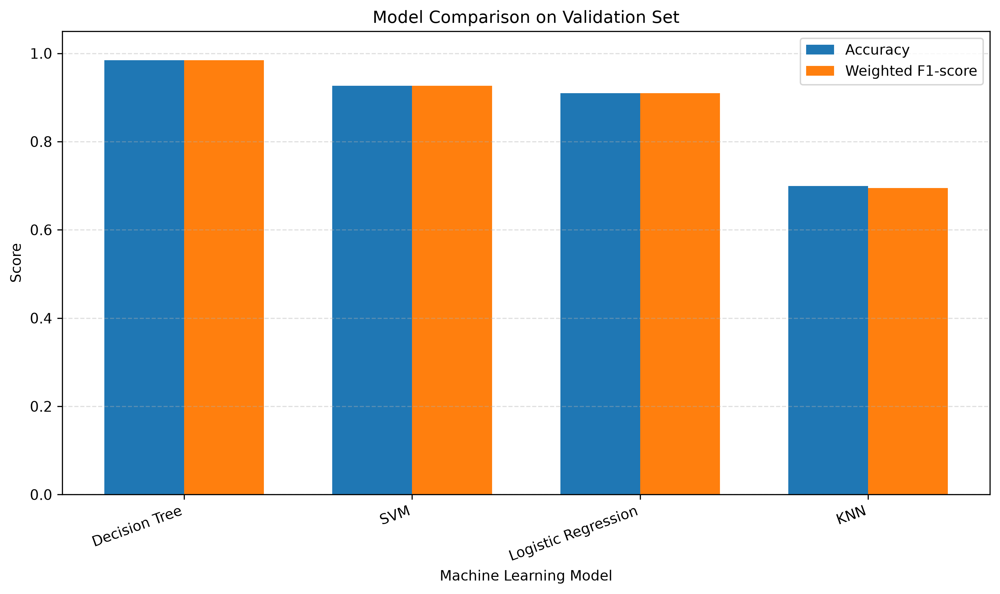
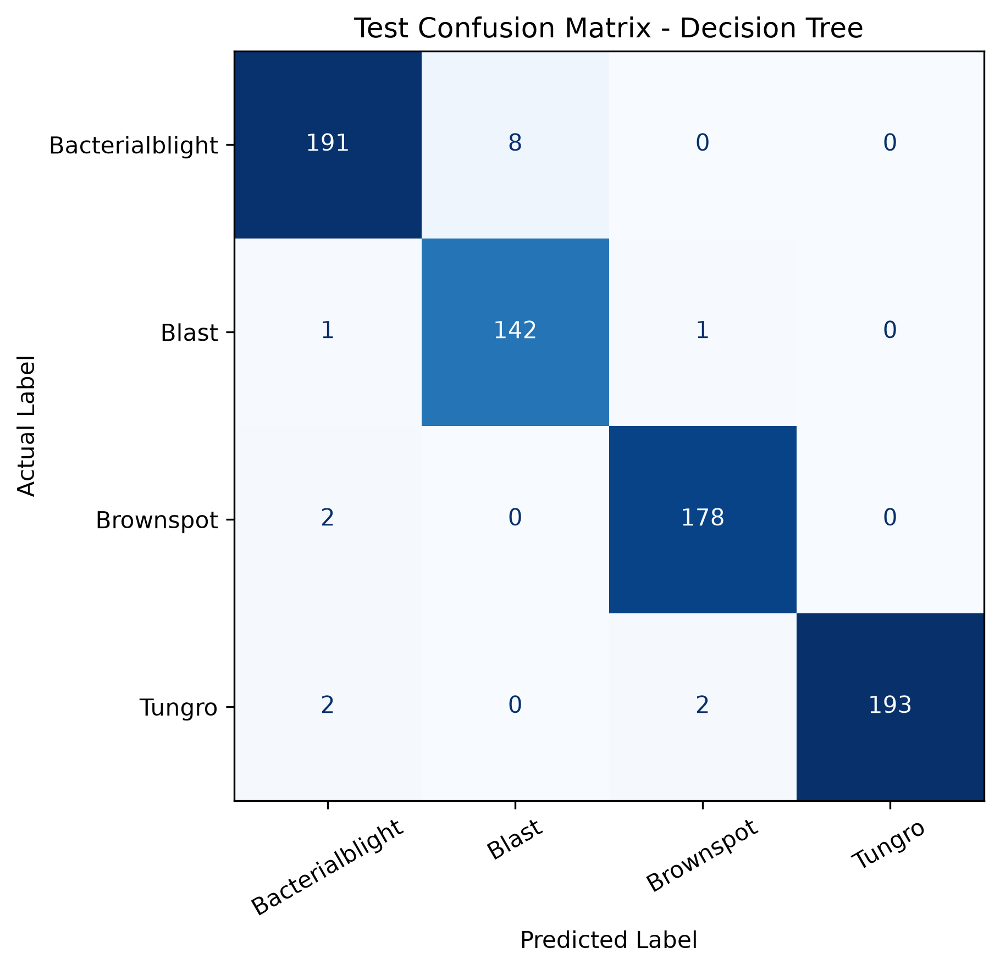

# 🌾 Rice Leaf Disease & Crop Advisory System

An ML mini-project that classifies rice leaf diseases from images and provides basic crop advisory information through an interactive Streamlit application.

## 📌 Project Overview

Rice plants can be affected by several diseases that reduce crop health and yield. This project uses image processing and machine learning to classify rice leaf images into four classes:

- Bacterialblight
- Blast
- Brownspot
- Tungro

The system extracts RGB color histogram and Histogram of Oriented Gradients (HOG) features and compares four machine learning algorithms.

## ✨ Features

- Rice leaf image classification
- Image preprocessing and duplicate detection
- RGB histogram and HOG feature extraction
- Comparison of four machine learning models
- Confusion matrices and evaluation metrics
- Interactive Streamlit dashboard
- Basic crop advisory information

## 🧠 Machine Learning Models

The following models are evaluated:

1. K-Nearest Neighbors (KNN)
2. Support Vector Machine (SVM)
3. Decision Tree
4. Logistic Regression

The Decision Tree was selected using validation weighted F1-score.

## 📊 Results

### Validation Set Comparison

| Model | Accuracy |
|---|---:|
| Decision Tree | 98.47% |
| SVM | 92.63% |
| Logistic Regression | 90.96% |
| KNN | 69.96% |

### Final Test Results

| Metric | Score |
|---|---:|
| Accuracy | 97.78% |
| Weighted Precision | 97.81% |
| Weighted Recall | 97.78% |
| Weighted F1-score | 97.78% |

The selected Decision Tree correctly classified 704 of 720 test images.

### Evaluation Plots

**Model comparison**



**Test confusion matrix**



**Validation confusion matrices**

- [Decision Tree](results/plots/confusion_matrix_decision_tree_validation.png)
- [SVM](results/plots/confusion_matrix_svm_validation.png)
- [Logistic Regression](results/plots/confusion_matrix_logistic_regression_validation.png)
- [KNN](results/plots/confusion_matrix_knn_validation.png)

## 🗂️ Project Structure

```text
Rice-Leaf-Disease-Crop-Advisory/
├── src/
│   ├── data_preprocessing.py
│   ├── feature_extraction.py
│   ├── train_models.py
│   └── advisory.py
├── models/
│   └── best_model.joblib
├── results/
│   ├── metrics/
│   └── plots/
├── app.py
├── requirements.txt
├── README.md
└── .gitignore
```

## ⚙️ Installation and Setup

### 1. Clone the repository

```bash
git clone https://github.com/aditidhamankar88-dot/Rice-Leaf-Disease-Crop-Advisory.git
cd Rice-Leaf-Disease-Crop-Advisory
```

### 2. Create a virtual environment

```bash
python -m venv .venv
```

Activate it on Windows PowerShell:

```powershell
.\.venv\Scripts\Activate.ps1
```

### 3. Install dependencies

```bash
pip install -r requirements.txt
```

### 4. Add the dataset

Place the dataset in the following location:

```text
dataset/
└── Rice Leaf Disease Images/
    ├── Bacterialblight/
    ├── Blast/
    ├── Brownspot/
    └── Tungro/
```

The dataset is not included in this repository.

### 5. Run the application

```bash
streamlit run app.py
```

## 🛠️ Technologies Used

- Python
- Scikit-learn
- NumPy
- Pandas
- Pillow
- Scikit-image
- Matplotlib
- Streamlit
- Joblib

## ⚠️ Limitations

- Predictions depend on image quality and dataset diversity.
- Performance on unseen field images may differ from the reported test results.
- The advisory is intended for educational purposes and should not replace expert agricultural diagnosis.

## 👩‍💻 Project Information

**Project:** Rice Leaf Disease & Crop Advisory System  
**Type:** Machine Learning Mini-Project


